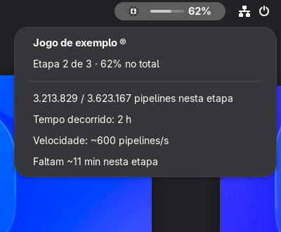

# Steam Shaders

**English** · [Português do Brasil](README.pt-BR.md)

Follow Steam's background shader compilation without keeping its downloads page open.
See the game, Steam's reported percentage, the current stage, a stage estimate and recent history.

The monitor runs offline, reads Steam's logs and game manifests, and checks your user's
`fossilize_replay` processes. It does not change games, Steam settings or shader caches.
The Python monitor uses only the standard library.

**Version 0.2.0 is a development release.** It includes a Linux desktop installation and
a Decky plugin installable from URL or ZIP ([Decky guide](docs/decky.md)). The Decky build
has not yet been tested on a real Steam Deck and is not listed in the Decky Plugin Store.

> **Interface language:** terminal messages, the GNOME indicator and the Decky panel are
> currently in Brazilian Portuguese. The documentation is available in English and Portuguese.

## Choose an interface

| Interface | Requirements | Validation so far |
|---|---|---|
| Terminal and desktop notifications | Linux, Python 3.9+, optional `notify-send` | Automated monitor, discovery and installer tests |
| GNOME top bar | GNOME Shell 51; desktop monitor | Isolated GNOME 51 graphical smoke test |
| Decky quick access menu | Decky Loader; no separate desktop installation | TypeScript build and backend lifecycle tests with a simulated Decky API; hardware validation pending |

GNOME 51 preview with a fictional game and simulated progress:



The desktop monitor works independently of GNOME. KDE, XFCE and other desktops can use
its terminal output and notifications. Their panels do not receive a native indicator.
Other GNOME versions are not yet declared compatible. SteamOS validation is tracked in
[the Decky guide](docs/decky.md).

Steam discovery covers native installations (`~/.local/share/Steam`, `~/.steam/steam`,
`~/.steam/root`, `~/.steam/debian-installation`), Flatpak and a best-effort Snap path.
These paths are covered with temporary fixtures; Flatpak/Snap sandbox combinations still
need real-world reports. When more than one installation exists, the newest shader log wins
at startup. Pin a custom path in the configuration if needed.

## Install on a Linux desktop

Install Python 3.9 or newer from your distribution, then download the latest release and run
its installer:

```sh
curl -fL https://github.com/RonyNjr/SteamCompShaderUI/releases/latest/download/steam-shaders-desktop.tar.gz | tar xz
cd steam-shaders
python3 install.py --activate
```

The archive (about 30 KB) contains only the program, the GNOME extension and the license.
You can also download it from the [releases page](https://github.com/RonyNjr/SteamCompShaderUI/releases)
or run `install.py` from a `git clone` of this repository.

Run this as your normal user, **without sudo**. No pip or Node.js is needed for desktop use.
The installer copies the application into `~/.local/lib/steamcompshaderui`, adds
`~/.local/bin/steam-shaders`, and chooses a user systemd service when available. Otherwise,
it uses your desktop's XDG autostart facility. A systemd installation also has an XDG entry
that starts the same unit on desktops that do not activate `graphical-session.target`.

On a supported GNOME session, it also installs the top-bar extension. A new extension or
an update may need a logout/login. Save your work first; the installer never logs you out.
The indicator is hidden while idle.

Notifications require `notify-send` and a running desktop notification server:

```sh
# Debian / Ubuntu
sudo apt install libnotify-bin
# Fedora
sudo dnf install libnotify
# Arch Linux
sudo pacman -S libnotify
```

Only run the command for your distribution. Notifications are optional; monitoring continues
if the notification utility is absent.

```sh
steam-shaders doctor
steam-shaders status
steam-shaders status --json
```

If your shell has not added `~/.local/bin` to `PATH`, use `~/.local/bin/steam-shaders` directly.
`doctor` prints paths and available features without changing your system. `status` rejects
stale state rather than showing old progress as current.

To update, repeat the commands above (or `git pull` in a clone) and run the installer again.
For a preview that does not change your session:

```sh
python3 install.py --root /tmp/steam-shaders-preview
```

Advanced options:

```sh
python3 install.py --activate --startup autostart --gnome no
python3 install.py --startup none --gnome no
steam-shaders run --steam-dir /path/to/Steam
steam-shaders stop
```

`--startup none` removes this application's startup entries and leaves manual operation
available. `stop` stops the current monitor; configured startup remains for your next login.

### Hyprland, sway and i3

These compositors do not run XDG autostart entries by default, so the monitor may not start
after a reboot. `steam-shaders doctor` detects them and prints the exact line to add to your
compositor configuration. For the default systemd installation:

```text
# Hyprland (~/.config/hypr/hyprland.conf)
exec-once = systemctl --user start steam-shaders.service
# sway (~/.config/sway/config)
exec systemctl --user start steam-shaders.service
# i3 (~/.config/i3/config)
exec --no-startup-id systemctl --user start steam-shaders.service
```

With `--startup autostart`, use `~/.local/bin/steam-shaders run` as the command instead.

## Configuration and data

Create `~/.config/steamcompshaderui/config.json` only if you want to override defaults:

```json
{
  "steam_dir": "/absolute/path/to/Steam",
  "notifications": false
}
```

Omit `steam_dir` for automatic detection. Command-line `--steam-dir` takes precedence.
`XDG_CONFIG_HOME` and `XDG_DATA_HOME` are respected; empty or relative values use the
standard defaults. The Steam Flatpak is monitored from the host; this project does not
install anything inside its sandbox.

| Location | Contents |
|---|---|
| `~/.local/share/steamcompshaderui/` | `status.json`, `checkpoint.json`, `history.sqlite3`, process lock |
| `~/.config/steamcompshaderui/` | Optional configuration |
| `~/.config/systemd/user/steam-shaders.service` | User service, when selected |
| `~/.config/autostart/steam-shaders.desktop` | Login startup, when enabled |
| `~/.local/share/gnome-shell/extensions/steam-shaders@rony.local/` | Optional GNOME extension |

The existing extension UUID and data location are retained for upgrades from 0.1.
Decky keeps its own data under Decky's runtime directory instead.

Remove the desktop installation with:

```sh
steam-shaders uninstall
# Or, from the source directory:
python3 install.py --uninstall
```

Removal asks for confirmation and preserves history and configuration. With the autostart
backend, diagnostic output from activation is in the data directory's `monitor.log`.
For systemd:

```sh
systemctl --user status steam-shaders.service
journalctl --user -u steam-shaders.service -n 30 --no-pager
```

## Accuracy and limitations

- Percentages come from Steam. Estimates cover **only the current stage**, and disappear
  when progress becomes stale or the counters reset. The three-stage interpretation is based
  on observed Steam logs and may change with Steam updates.
- Only an explicit `fossilize_replay completed` line confirms success. A destroyed job or
  vanished process is recorded as interrupted. Completion waits 15 seconds to group immediate
  restarts of the same game.
- Rotation and checkpoints reduce missed events, but logs deleted before they can be read
  cannot be reconstructed. A process found mid-compilation has an unknown original start time.
- Steam's shader pre-caching must produce `logs/shader_log.txt`. Flatpak/Snap permissions
  and restricted `/proc` access can limit detection. Steam must run as the same user.
- One Steam installation is monitored per instance. Changing the selected installation resets
  its log checkpoint. This is not a total compilation-time predictor or a shader download meter.

## Development

The repository separates application code, desktop integrations and generated files:

```text
steam_shaders/       Python monitor, CLI, installer and Decky backend
integrations/
  gnome/             GNOME Shell extension
  decky/             Decky frontend
  shared/            Presentation model shared by both interfaces
tests/               Python tests, frontend checks and graphical integration test
scripts/             Build and packaging tools
docs/                Installation details and screenshots
build/               Generated build files (ignored by Git)
dist/                Distributable ZIP files (ignored by Git)
```

`install.py` is the desktop installation entry point. `main.py` is the entry point required
by Decky Loader. From a checkout, `python3 -m steam_shaders` runs the CLI without installation.
Installed application files and user data live outside the repository.

```sh
python3 -m unittest discover -s tests -v
gjs -m tests/frontend/model.test.js           # optional presentation checks
python3 tests/integration/gnome_smoke.py         # optional GNOME 51 graphical environment
```

The GNOME smoke test uses temporary XDG directories and a separate D-Bus session.
For the Decky frontend, install Node.js 22+ and pnpm 9, then:

```sh
pnpm install --frozen-lockfile
pnpm run typecheck
pnpm run build
pnpm test
pnpm run package
```

The resulting `dist/steam-shaders-0.2.0.zip` includes the monitor. The end user does not
need Node.js, pnpm, pip or a separately installed service. See [docs/decky.md](docs/decky.md)
for installation and the current store-submission restriction.

To publish a release, update the version in `package.json`, `steam_shaders/support.py` and
`integrations/gnome/metadata.json`, date the CHANGELOG entry, then push a matching tag
(for example `git tag v0.2.0 && git push origin v0.2.0`). CI runs every check and attaches the
Decky ZIP and the desktop archive to the GitHub release, each with a versioned and a fixed name.

Licensed under [MIT](LICENSE). Independent community project; not affiliated with Valve,
Steam, GNOME or Decky Loader. See [CHANGELOG.md](CHANGELOG.md).
