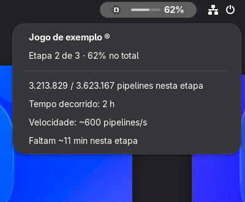

# Steam Shaders

[English](README.md) · **Português do Brasil**

Acompanhe a compilação de shaders da Steam sem deixar a página de downloads aberta.
Mostra jogo, porcentagem informada pela Steam, etapa, estimativa da etapa e histórico.

**Versão 0.2.1 em desenvolvimento.** Inclui a instalação para desktop Linux e um plugin
Decky instalável por URL ou ZIP ([guia do Decky](docs/decky.pt-BR.md)). O plugin ainda
precisa ser validado em um Steam Deck real e não está na loja do Decky.

## Compatibilidade

| Recurso | Requisitos e situação |
|---|---|
| Monitor e comando no terminal | Linux com Python 3.9 ou mais recente; somente biblioteca padrão |
| Notificação de conclusão | `notify-send` e notificações da sessão gráfica; recurso opcional |
| Indicador na barra do GNOME | GNOME Shell 51, com teste gráfico isolado |
| KDE, XFCE e outros desktops | Monitor, terminal e notificações; sem indicador nativo no painel |
| Menu do Decky Loader | Build e testes do backend passando; validação no Steam Deck pendente |
| Steam nativa e Flatpak | Detecção dos caminhos comuns; testes com diretórios simulados |
| Steam Snap | Caminho incluído como tentativa; permissões e execução real ainda não validadas |

Prévia no GNOME 51 com jogo fictício e progresso simulado:



Isso permite usar o monitor em outras distribuições sem depender do GNOME ou do systemd.
Não significa que todas as distribuições e versões de desktop já foram testadas.
Outras versões do GNOME ainda não são declaradas compatíveis.

## Instalação no desktop

Com Python 3.9+ instalado, baixe a release mais recente e execute o instalador:

```sh
curl -fL https://github.com/RonyNjr/SteamCompShaderUI/releases/latest/download/steam-shaders-desktop.tar.gz | tar xz
cd steam-shaders
python3 install.py --activate
```

O arquivo (cerca de 30 KB) contém só o programa, a extensão do GNOME e a licença. Também é
possível baixá-lo na [página de releases](https://github.com/RonyNjr/SteamCompShaderUI/releases)
ou executar o `install.py` a partir de um `git clone` deste repositório.

Execute **sem sudo**. O programa é instalado só no seu usuário, sem pip e sem Node.js.
O instalador escolhe systemd de usuário quando disponível; caso contrário, cria uma entrada
no autostart XDG, que é a pasta usada pelo desktop para abrir programas ao fazer login.
No modo systemd, essa entrada inicia a mesma unidade, inclusive em desktops que não
ativam o alvo de sessão gráfica do systemd.

A extensão da barra só é instalada automaticamente em uma sessão GNOME compatível.
Pode ser necessário sair e entrar na sessão para carregar a extensão nova ou atualizada.
O instalador não encerra a sessão. Sem compilação, o indicador fica oculto.

Para receber notificações, instale o pacote da sua distribuição se ele ainda não existir:

```sh
# Debian / Ubuntu
sudo apt install libnotify-bin
# Fedora
sudo dnf install libnotify
# Arch Linux
sudo pacman -S libnotify
```

Escolha somente o comando correspondente ao seu sistema. O monitor funciona também sem
notificações. Nenhum arquivo da Steam, jogo ou cache é modificado.

```sh
steam-shaders doctor
steam-shaders status
steam-shaders status --json
```

`doctor` mostra caminhos e recursos disponíveis, sem alterar o sistema. `status` mostra o
progresso e recusa informações antigas se o monitor parar. Se o comando não for encontrado,
use `~/.local/bin/steam-shaders` até o seu shell incluir essa pasta no `PATH`.

Para atualizar, repita os comandos acima (ou `git pull` em um clone) e execute o instalador
de novo. Para preparar uma cópia temporária sem mudar sua sessão:

```sh
python3 install.py --root /tmp/steam-shaders-revisao
```

Outras formas de instalar e iniciar:

```sh
python3 install.py --activate --startup autostart --gnome no
python3 install.py --startup none --gnome no
steam-shaders run --steam-dir /caminho/da/Steam
steam-shaders stop
```

`--startup none` remove as entradas de inicialização do aplicativo e permite execução manual.
`stop` encerra o monitor atual; a inicialização configurada continua valendo no próximo login.

### Pacote para Arch Linux

Em distribuições baseadas no Arch (Arch, CachyOS, EndeavourOS, Manjaro), é possível gerar um
pacote gerenciado pelo pacman a partir do PKGBUILD deste repositório:

```sh
git clone https://github.com/RonyNjr/SteamCompShaderUI.git
cd SteamCompShaderUI/packaging/aur
makepkg -si
systemctl --user enable --now steam-shaders.service
```

O pacote instala em `/usr`; atualize ou remova pelo pacman. Se você usou o `install.py` antes,
rode `~/.local/bin/steam-shaders uninstall` primeiro. A publicação no AUR está prevista para
quando o cadastro de contas reabrir.

### Hyprland, sway e i3

Esses compositores não executam o autostart XDG por padrão, então o monitor pode não iniciar
depois de reiniciar o computador. `steam-shaders doctor` identifica esses ambientes e mostra a
linha exata para a configuração do compositor. Na instalação padrão com systemd:

```text
# Hyprland (~/.config/hypr/hyprland.conf)
exec-once = systemctl --user start steam-shaders.service
# sway (~/.config/sway/config)
exec systemctl --user start steam-shaders.service
# i3 (~/.config/i3/config)
exec --no-startup-id systemctl --user start steam-shaders.service
```

Com `--startup autostart`, use `~/.local/bin/steam-shaders run` como comando.

## Caminhos e configuração

A busca inclui `~/.local/share/Steam`, os links em `~/.steam`, a pasta Debian e
`~/.var/app/com.valvesoftware.Steam/.local/share/Steam`. Também inclui uma tentativa de
localização em `~/snap/steam/common/.local/share/Steam`. Com mais de uma instalação,
o log de shaders modificado mais recentemente define qual será acompanhada ao iniciar.

Para escolher manualmente, crie `~/.config/steamcompshaderui/config.json`:

```json
{
  "steam_dir": "/caminho/absoluto/da/Steam",
  "notifications": false
}
```

Sem `steam_dir`, a detecção é automática. `--steam-dir` no terminal tem prioridade.
`XDG_DATA_HOME` e `XDG_CONFIG_HOME` são respeitados, usando os padrões quando vazios
ou relativos. O monitor da Steam Flatpak roda no sistema principal, fora do sandbox.

| Pasta/arquivo | Para que serve |
|---|---|
| `~/.local/lib/steamcompshaderui/` | Cópia do programa, independente da pasta do repositório |
| `~/.local/bin/steam-shaders` | Comando para terminal |
| `~/.local/share/steamcompshaderui/` | Estado, cursor do log, histórico SQLite e trava do processo |
| `~/.config/steamcompshaderui/` | Configuração opcional |
| `~/.config/systemd/user/steam-shaders.service` | Serviço de usuário, quando selecionado |
| `~/.config/autostart/steam-shaders.desktop` | Inicialização ao entrar na sessão |

O UUID da extensão e os caminhos de dados antigos foram preservados para permitir atualizar
quem já instalou a versão 0.1. O plugin Decky usa seus próprios diretórios de dados.

## Desinstalar e diagnosticar

```sh
steam-shaders uninstall
# Ou, na pasta do repositório:
python3 install.py --uninstall
```

A desinstalação pede confirmação e mantém histórico e configuração.
No modo autostart, a saída do monitor iniciado pelo instalador fica em
`~/.local/share/steamcompshaderui/monitor.log`. No modo systemd:

```sh
systemctl --user status steam-shaders.service
journalctl --user -u steam-shaders.service -n 30 --no-pager
```

Uma leitura isolada, sem notificações nem interferência no serviço:

```sh
python3 -m steam_shaders run --once --no-notifications --data-dir /tmp/steam-shaders-diagnostico
```

## Precisão e limites

- A porcentagem é a informada pela Steam. A estimativa vale **só para a etapa atual** e
  desaparece quando o contador reinicia ou fica antigo. A interpretação em três etapas
  vem de logs observados e pode mudar com atualizações da Steam.
- A conclusão depende da linha explícita `fossilize_replay completed`. Processo que desaparece
  ou job destruído sem essa confirmação vira interrupção. O aviso espera 15 segundos para
  agrupar reinícios imediatos do mesmo jogo.
- A leitura incremental e o cursor ajudam em rotações, mas não recuperam logs já apagados.
  O início é marcado como desconhecido se o monitor chega no meio da compilação.
- É preciso que a Steam produza o `logs/shader_log.txt`. Pré-cache desativado, permissões
  do Flatpak/Snap ou restrições em `/proc` podem limitar os dados. A Steam precisa rodar
  no mesmo usuário que o monitor.
- Cada instância acompanha uma instalação da Steam. Não mede volume de downloads nem
  estima o tempo total de todas as etapas.

## Desenvolvimento

O código, as integrações e os arquivos gerados ficam separados:

```text
steam_shaders/       Monitor Python, terminal, instalador e backend Decky
integrations/
  gnome/             Extensão do GNOME Shell
  decky/             Interface do Decky
  shared/            Apresentação compartilhada pelas interfaces
tests/               Testes Python, de interface e de integração gráfica
scripts/             Ferramentas de build e empacotamento
docs/                Documentação de instalação e imagens
build/               Arquivos temporários gerados (ignorados pelo Git)
dist/                ZIPs para distribuição (ignorados pelo Git)
```

`install.py` inicia a instalação no desktop. `main.py` é a entrada exigida pelo Decky Loader.
Na pasta do repositório, `python3 -m steam_shaders` executa o comando sem instalar.
O programa instalado e os seus dados ficam fora da pasta do repositório.

```sh
python3 -m unittest discover -s tests -v
gjs -m tests/frontend/model.test.js
python3 tests/integration/gnome_smoke.py
```

Os dois últimos testes são opcionais e precisam de GJS/GNOME. O teste gráfico usa sessão
D-Bus e pastas temporárias, sem alterar a sessão atual.

Para compilar o Decky, use Node.js 22+ e pnpm 9:

```sh
pnpm install --frozen-lockfile
pnpm run typecheck
pnpm run build
pnpm test
pnpm run package
```

O ZIP fica em `dist/steam-shaders-<versão>.zip`. Quem instala o ZIP no Decky não precisa
instalar pnpm, Node.js, pip ou o serviço do desktop. As instruções e a restrição atual da
loja estão em [docs/decky.pt-BR.md](docs/decky.pt-BR.md).

Para publicar uma release, atualize a versão em `package.json`, `steam_shaders/support.py` e
`integrations/gnome/metadata.json`, coloque a data no CHANGELOG e envie uma tag correspondente
(por exemplo `git tag v0.2.1 && git push origin v0.2.1`). O CI roda todas as verificações e
anexa à release o ZIP do Decky e o arquivo desktop, cada um com nome versionado e nome fixo.

Licença [MIT](LICENSE). Projeto independente, sem vínculo com Valve, Steam, GNOME ou Decky.
Veja o [histórico de versões](CHANGELOG.md).
